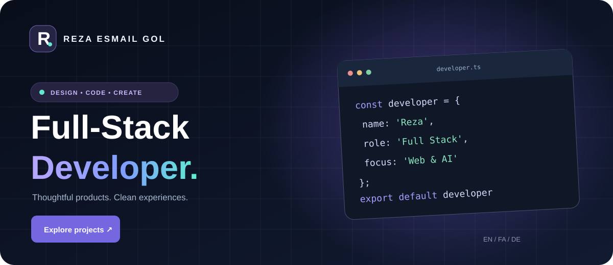

# Reza Esmail Gol — Multilingual Developer Portfolio

**English · فارسی · Deutsch** &nbsp; | &nbsp; **Vanilla JavaScript · Responsive · RTL/LTR · Light/Dark**

A lightweight, modern developer portfolio with selected open-source projects, multilingual content, accessible navigation, responsive layouts and a polished design system.

> **Status:** This redesigned version lives in `feat/professional-multilingual-portfolio-2026` until its pull request is reviewed and merged into `main`. Project descriptions are illustrative summaries of public repositories, not claims about production deployment or measurable results.



*Design illustration (not a live browser screenshot). For a verified screenshot, run the site locally and capture it in a browser.*

## Highlights

- **Three complete languages:** English (EN), Persian (FA, right-to-left) and German (DE), from a local, valid [`languages.json`](languages.json) file.
- **Responsive design:** Navigation, hero layout, capability cards, project grid and contact section adjust for desktop, tablet and mobile.
- **Light and dark themes:** Respects the operating-system preference until changed, then remembers the user's selection.
- **Real GitHub projects:** Six manually curated public-repository links and an “Explore more” link.
- **Project filters:** Switch between all projects, web/apps and AI/tools.
- **Accessibility basics:** Semantic sections, skip link, focus states, keyboard-friendly menu controls, ARIA states, reduced-motion support and clear contrast.
- **Search-friendly foundation:** Descriptive metadata, social preview text, JSON-LD person profile and an SVG favicon.
- **Lightweight stack:** Plain HTML, CSS and JavaScript. No build step, frontend framework, npm dependencies or external translation endpoint.

### Selected repositories

| Project | Repository | Topic |
|---|---|---|
| Chat Video Studio | [GitHub](https://github.com/RezaEsmailGol/chat-video-studio) | Chat-to-video creative tooling |
| Menschen A1.1 Companion | [GitHub](https://github.com/RezaEsmailGol/Menschen.A1.1) | Interactive German practice |
| SEO Mind | [GitHub](https://github.com/RezaEsmailGol/seomind) | Python / search optimization |
| Lahne Man | [GitHub](https://github.com/RezaEsmailGol/lahne-man) | Python / voice tooling |
| WP Booster | [GitHub](https://github.com/RezaEsmailGol/wp-booster) | WordPress / performance |
| Multilingual Portfolio | [GitHub](https://github.com/RezaEsmailGol/Portfolio-website-multi-langual) | This website |

**Important:** Only public repositories are linked. Project descriptions can be refined as the related repositories evolve. No unverified experience years, revenue, client counts or performance metrics are published.

## Run locally

Clone the correct repository and start any static HTTP server:

```bash
git clone https://github.com/RezaEsmailGol/Portfolio-website-multi-langual.git
cd Portfolio-website-multi-langual
git switch feat/professional-multilingual-portfolio-2026

# Python 3:
python -m http.server 8000
```

Open **http://localhost:8000**. You can also use VS Code Live Server.

**Do not open `index.html` using a `file://` URL.** Fetching local JSON via the `fetch` API is blocked by many browsers under the file protocol. The initial English HTML is still readable as a fallback.

### Running checks

Node.js 20+ (only for development checks, not for the website itself):

```bash
node --check script.js
node --test tests/site.test.mjs
```

The GitHub Actions workflow [`quality.yml`](.github/workflows/quality.yml) runs these checks on pushes and pull requests. These tests are static safety and content checks; real device and browser QA remains necessary before promoting to production.

## Structure

```text
.
├── index.html                  # Semantic sections, curated project cards and SEO markup
├── styles.css                  # Responsive themes, layouts and RTL support
├── script.js                   # Languages, theme, filters, navigation
├── languages.json              # EN / FA / DE translations
├── favicon.svg                 # Brand favicon
├── docs/
│   └── portfolio-illustration.svg  # Lightweight design illustration
├── tests/
│   └── site.test.mjs           # Local content / structure checks
└── .github/workflows/
    └── quality.yml             # CI checks
```

The legacy `test.php` is **not part of the new frontend**, and the site no longer fetches translations from an external HTTP URL. Legacy screenshots and illustration assets have been retained in the repository for reference.

### Updating your information

1. Edit your project cards and GitHub URLs inside `index.html`.
2. Edit section headings and descriptions inside `languages.json` **in all three languages**, using identical translation keys.
3. Change the public email in `index.html` and the Person JSON-LD block if needed.
4. Update colors, spacing and typography using CSS custom properties in `styles.css`.
5. Re-run the automated checks and review at mobile widths, especially after adding long text translations.

The site uses Google Fonts for Inter and Vazirmatn, with system font fallbacks. To be fully self-hosted/offline, bundle correctly licensed fonts or rely on the system fallbacks. The contact button uses **mailto**, not a backend contact form. No data is submitted to a server.

## Deploy

Deploy the static root to GitHub Pages, Vercel, Netlify or any static host. When using GitHub Pages, select **Deploy from a branch** and publish from the chosen branch's root, or configure a Pages workflow. Do not assume deployment is active just because commits exist.

Before publishing: configure a real site URL, adjust social preview image URLs to a publicly hosted raster asset if desired, verify external links, and test Firefox, Chrome, Safari/iOS and Android. Add a privacy policy only if you later introduce analytics, server forms or tracking.

## Security and privacy

- No API keys, tokens or private project details in the client.
- No HTML injection from translation strings: content is written using `textContent`.
- Only a language and theme preference are stored in `localStorage`.
- External GitHub links use `rel="noopener noreferrer"`.
- External translation API and its HTTP mixed-content dependency were removed.

---

## معرفی پروژه به فارسی

**پورتفولیوی حرفه‌ای، سبک و سه‌زبانه برای معرفی توسعه‌دهنده و نمونه‌کارهای واقعی**

این پروژه، نسخه بازطراحی‌شده وب‌سایت شخصی رضا اسماعیل گل است. تمرکز اصلی آن بر ظاهر مدرن، سرعت بارگذاری، تجربه کاربری روان و نمایش پروژه‌های عمومی GitHub قرار دارد.

**امکانات اصلی:** پشتیبانی از فارسی راست‌به‌چپ، انگلیسی و آلمانی؛ حالت تاریک و روشن؛ سازگاری با موبایل و دسکتاپ؛ نمایش و فیلتر نمونه‌کارها؛ بخش تخصص‌ها، معرفی شخصی و ارتباط از طریق ایمیل؛ ساختار معنایی و امکانات اولیه سئو و دسترس‌پذیری.

**اجرای محلی:** پس از دریافت کدها، فرمان `python -m http.server 8000` را اجرا کرده و آدرس `http://localhost:8000` را باز کنید. برای تست ساختار و ترجمه‌ها از `node --test tests/site.test.mjs` استفاده کنید.

**نکته:** تصویر بالای README یک طرح گرافیکی از زبان بصری محصول است، نه اسکرین‌شات تست‌شده. دکمه تماس در حال حاضر نرم‌افزار ایمیل را باز می‌کند و فرم ارسال پیام به سرور وجود ندارد. پیش از انتشار عمومی باید تست مرورگرهای واقعی انجام شود.

## Deutsche Kurzbeschreibung

Ein modernes, responsives **Full-Stack-Entwicklerportfolio** in Englisch, Persisch (RTL) und Deutsch. Die Website zeigt reale öffentliche GitHub-Projekte und bietet ein barrierebewusstes Navigationskonzept, Projektfilter sowie einen hellen und dunklen Modus. Entwickelt mit HTML, CSS und Vanilla JavaScript – ohne Framework oder Build-Prozess.

**Lokal starten:** `python -m http.server 8000` und im Browser `http://localhost:8000` öffnen. Der Kontakt-Button verwendet `mailto:`; es gibt kein Backend-Kontaktformular. Der Header oben ist eine Illustration, kein bestätigter Live-Screenshot.

---

### License / مجوز

No standalone license file was present in the original repository. **Do not assume an open-source redistribution license** until the repository owner selects and adds one. Public source code visibility alone is not an open-source license.

Developed and maintained by [Reza Esmail Gol](https://github.com/RezaEsmailGol).
